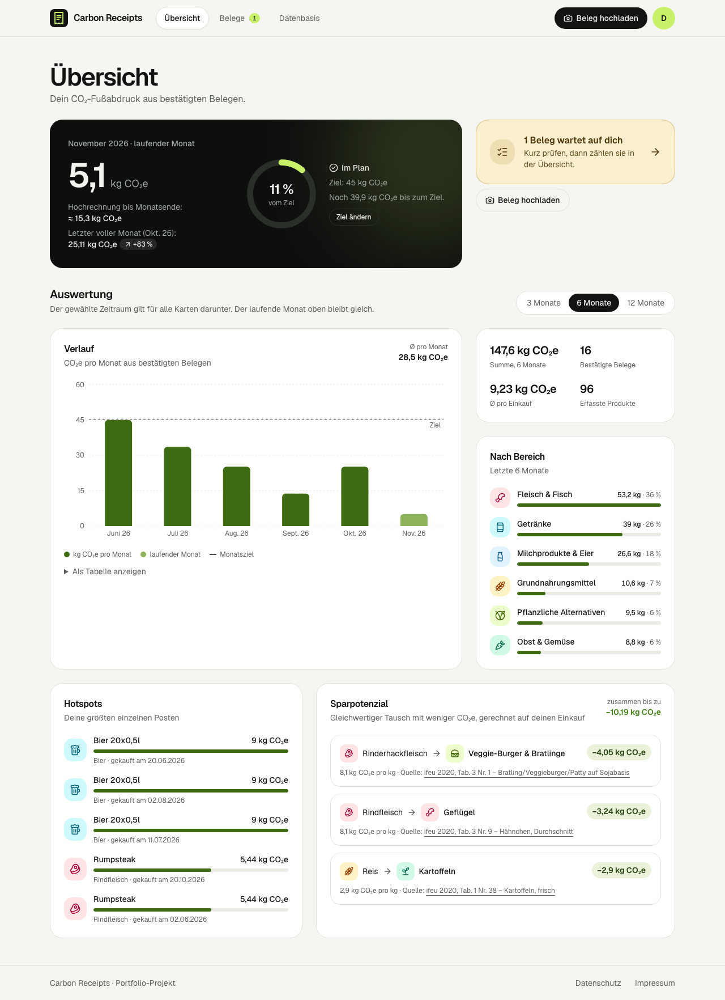
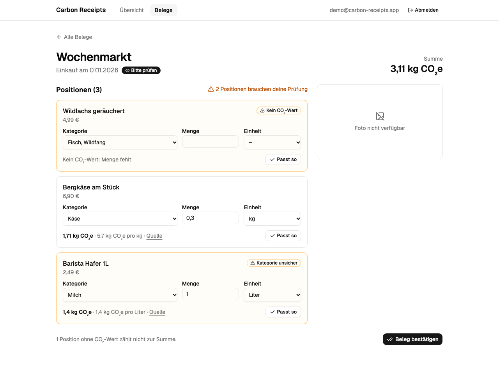
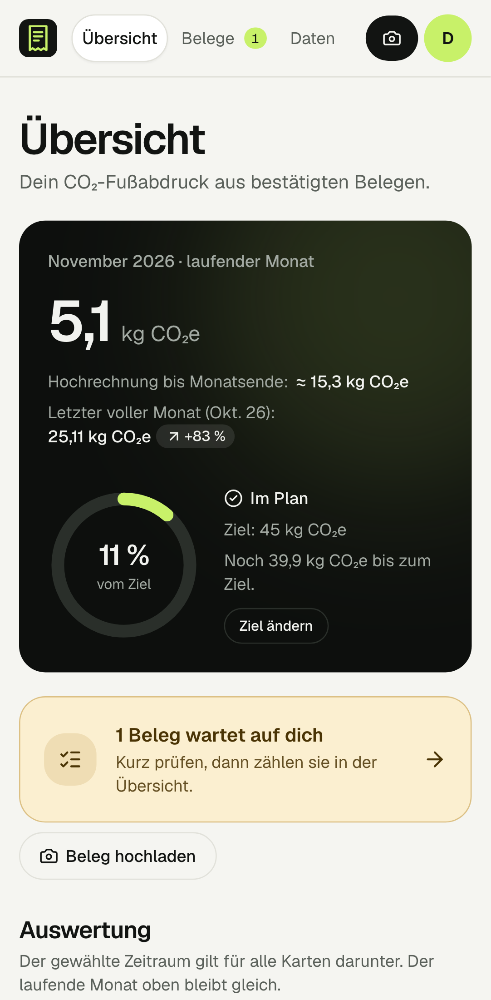
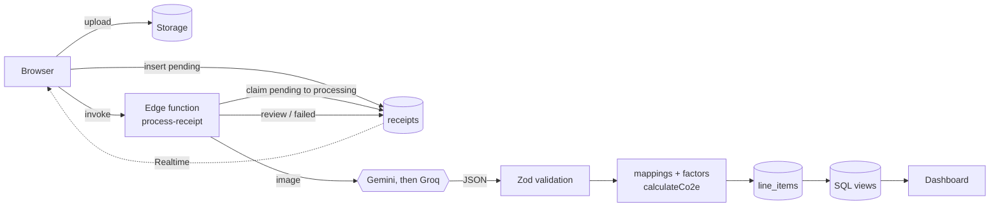

# Carbon Receipts

[](https://github.com/julian-orth/carbon-receipts/actions/workflows/ci.yml)

Photograph a grocery receipt and see its carbon footprint. An LLM reads the line items and
suggests a category; the app maps them to published emission factors and calculates CO₂e
deterministically. Uncertain matches go to a review screen, corrections are learned, and a
dashboard shows the trend, hotspots, concrete alternatives and a monthly goal.

> **The AI suggests, the code calculates.** The model only extracts text and proposes a category.
> Every CO₂e value is `quantity × factor`, computed by one tested function and traceable to a
> table row in a published study.



| Review                                 | Mobile                                                                                  |
| -------------------------------------- | --------------------------------------------------------------------------------------- |
|  |  |

## Features

- **Magic-link login** (PKCE) and an optional public demo account
- **Photo upload** to private storage, processed by an edge function in the background; the list
  follows the status live via Realtime
- **LLM pipeline** with Gemini Flash, Groq as fallback, exponential backoff, Zod validation of
  every response, a daily quota per user and a deterministic mock provider for local work and E2E
- **Missing amounts handled**: real receipts rarely print pack sizes, so the model may suggest a
  typical one – stored as `estimated` and flagged, never silently trusted
- **Review screen** with confidence flags, a live CO₂e preview, the factor and its source
- **Learns from every confirmation**: category _and_ amount per product; a correction is applied to
  other open items immediately, so the same fix is never needed twice
- **Dashboard** with monthly trend vs. goal, breakdown by area, top hotspots and like-for-like
  alternatives with the saving for the actual purchase
- **Data basis page** listing every emission factor with value, unit and the exact table row of its
  source, plus the known limits and a CSV download
- **Accessible**: semantic HTML, keyboard operable, visible focus, table view for the chart, status
  never by colour alone, axe scan in E2E

## Architecture



- **Postgres does the guarding**: RLS on every table, explicit column grants (users cannot set a
  receipt's status on insert or write global mappings), a trigger that only allows the status
  transitions a user may make, and a composite foreign key that keeps line items on the owner's
  receipt.
- **One calculation module** in `supabase/functions/_shared/emissions/` is imported by both the
  React app and the Deno edge function, so the preview in the review screen is exactly what gets
  stored.
- **Aggregations are SQL views** with `security_invoker`, so RLS applies to them too.

The reasoning behind these and other choices – including what was traded away – is in
[`docs/decisions.md`](docs/decisions.md).

## Emission factors

- **Food & beverages:** ifeu (2020),
  [_Ökologische Fußabdrücke von Lebensmitteln und Gerichten in Deutschland_](https://www.ifeu.de/fileadmin/uploads/Reinhardt-Gaertner-Wagner-2020-Oekologische-Fu%C3%9Fabdruecke-von-Lebensmitteln-und-Gerichten-in-Deutschland-ifeu-2020.pdf)
  – "at the supermarket checkout" in Germany, reference year 2019
- **Fuel:** BAFU (2026),
  [_CO2-Emissionsfaktoren des Treibhausgasinventars der Schweiz_](https://www.bafu.admin.ch/dam/de/sd-web/NlGIhzJ8OW0t/CO2_Emissionsfaktoren_THG_Inventar.pdf)
  – combustion only

75 categories, each storing the table and row it comes from – including ready meals (per portion)
and pet food. Known limitations (system boundaries, density assumption for beverages, per-piece
eggs, a weaker source for pet food) are listed in decisions 011 and 019.

The values were transcribed from the studies into the migrations; nothing is fetched at runtime. They
are a fixed state (November 2026) and deliberately not updated – so a stored CO₂e value always
matches the table (decision 029). The in-app page "Datenbasis" shows the complete table.

## Tech stack

React 19 · TypeScript (strict) · Vite · TanStack Query · React Router · Tailwind CSS + shadcn/ui ·
Recharts · Zod · React Hook Form · Supabase (Postgres, Auth, Storage, Realtime, Edge Functions) ·
Gemini Flash / Groq · Vitest + Testing Library · pgTAP · Playwright + axe · GitHub Actions · Vercel

## Quality

| Layer            | What                                                                                          |
| ---------------- | --------------------------------------------------------------------------------------------- |
| Unit & component | 248 Vitest tests: calculation, units, normalization, LLM fallback, Zod schema, all pages      |
| Database         | 55 pgTAP tests: RLS per role, grants, status transitions, quota, atomic processing, views     |
| Edge function    | Deno type check in CI                                                                         |
| End-to-end       | Playwright on desktop + mobile: magic link → upload → AI → Realtime → review → dashboard, axe |
| Static analysis  | strict TypeScript, type-aware lint (no floating promises, no unchecked casts), knip           |
| CI               | format, lint, knip, typecheck, tests, build · DB tests + types drift · Deno check · E2E       |

## Getting started

Requirements: Node 24, Docker (for local Supabase).

```bash
npm install
npm run db:start                    # local Supabase incl. demo data
cp .env.example .env.local          # fill in PUBLISHABLE_KEY from `supabase status`
cp supabase/functions/.env.example supabase/functions/.env   # LLM_PROVIDERS=mock needs no keys
npm run functions:serve             # second terminal
npm run dev
```

- App: http://localhost:5173 – "Demo ansehen" or magic link
- Mails: http://127.0.0.1:54324 (Mailpit) · Studio: http://127.0.0.1:54323
- Demo account: `demo@carbon-receipts.app` / `demo-carbon-receipts`

## Scripts

| Script                    | Purpose                                           |
| ------------------------- | ------------------------------------------------- |
| `npm run dev` / `build`   | Dev server / production build                     |
| `npm run typecheck`       | TypeScript project references                     |
| `npm run lint`            | oxlint, fails on warnings                         |
| `npm run format`          | Prettier (with Tailwind class ordering)           |
| `npm test`                | Vitest                                            |
| `npm run test:e2e`        | Playwright (needs `db:start` + `functions:serve`) |
| `npm run db:start`        | Start local Supabase                              |
| `npm run db:reset`        | Re-apply migrations + seed                        |
| `npm run db:test`         | pgTAP tests                                       |
| `npm run db:types`        | Regenerate database types                         |
| `npm run functions:serve` | Serve edge functions locally                      |
| `npm run functions:check` | Deno type check of the edge function              |

## Project structure

```
src/
  app/                 router, providers, layout, error boundary
  features/
    auth/              magic link, demo login, route guard
    receipts/          upload, list, realtime status
    review/            line item review and corrections
    dashboard/         trend, breakdown, hotspots, alternatives, goal
  components/ui/       shadcn/ui
supabase/
  migrations/          schema, RLS, grants, factors, views, demo function
  functions/
    _shared/           emissions module, LLM providers, pipeline, DB types
    process-receipt/   edge function
  tests/database/      pgTAP
e2e/                   Playwright
docs/                  decisions, deployment, screenshots
```

## Deployment

Step by step in [`docs/deploy.md`](docs/deploy.md): Supabase project, secrets, edge function,
auth URLs, demo account, Vercel, GitHub secrets.

## How this was built

This project was built with AI pair programming: the implementation was written together with
[Claude Code](https://www.anthropic.com/claude-code) (Anthropic), which is why commits list Claude as
co-author. The product idea, scope and requirements, the review of every change and the testing with
real receipts were done by me.

What that meant in practice:

- **Decisions are explicit.** Every non-obvious choice and its trade-off is written down in
  [`docs/decisions.md`](docs/decisions.md) – including the ones that turned out wrong and were
  revised (e.g. comparing a running month, an LLM model that disappeared, pack sizes missing on real
  receipts).
- **Nothing is trusted unverified.** Changes are backed by tests on every layer, a type-aware linter
  and CI; emission factors were read from the original studies, not generated.
- **Real data drove the design.** Testing with an actual Kaufland receipt showed that only 3 of 13
  items had an amount – which led to estimated amounts, the learning loop and the review flags.

## Privacy

The free tiers of Gemini and Groq may use submitted data to improve their models. The upload screen
says so, and the public demo uses sample data only.

## Next steps

- **Upstream emissions for fuel**, to match the life-cycle boundary of the food factors
- **Households / shared accounts**, PWA with offline capture, i18n

Deliberately left out: CSV bank exports and PDF import (decision 013) – a bank line has no items,
so only coarse spend-based factors (kg CO₂e per EUR, off by a factor of 2–5) would be possible,
and the one thing the app is good at, telling beef from vegetables, would be lost.
